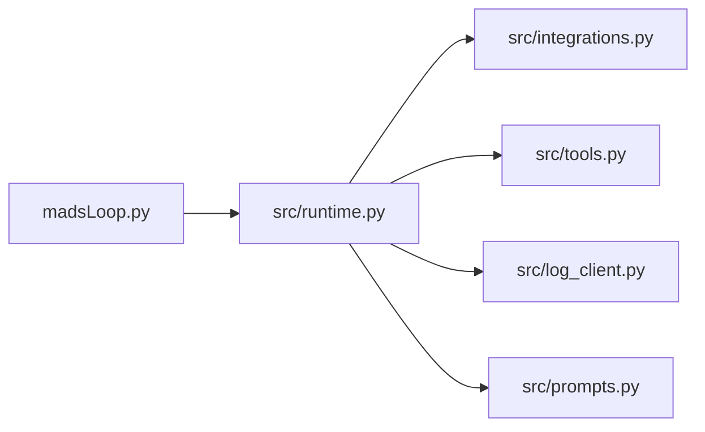

# Assignment 2 — madsLoop

本目录是实验二的运行根目录。当前[课程官网](https://cs2680.com/assignments/assignment2)要求在共享课程仓库中保留 `assignment2/`；本地 starter 的 `project_description_assignment.md` 末尾仍使用旧的 `<repo root>` 表述。这里按当前官网布局整理，后续 Assignment3 可以独立存放。

## 目录职责

```text
assignment2/
├── madsLoop.py                  # 命令行入口
├── docker_env.sh                # 容器内安装 harness 依赖
├── src/                         # harness 实现
│   ├── __init__.py
│   ├── runtime.py               # 模型与工具循环、对话历史
│   ├── tools.py                 # 工具定义和执行
│   ├── prompts.py               # 系统提示词
│   ├── integrations.py          # 模型 API client
│   └── log_client.py            # JSONL 运行日志
├── evaluation_scripts/          # 课程提供的任务与评测脚本
├── developer_logs/              # 待收集真实开发会话 JSONL
├── mytest/                      # 待完成的四个自建评测任务
│   ├── README.md                # 所需文件和当前完成状态
│   ├── tasks/                   # 每个任务的 Dockerfile、gold.diff
│   └── results/                 # 每个任务的 before/after 日志
├── tests/                       # harness 自身的离线测试和 API 联调
│   ├── test_runtime_logging.py
│   └── smoke_test.py
├── docs/                        # 学习笔记
│   └── Part1工作心得.md
└── project_description_assignment.md  # 原始作业说明
```

官网中的 `src/agentic_loop.py` 是示例名称；这里沿用已有 `runtime.py`。
`madsLoop_logs/` 在当前工作目录开启 `--log` 运行时生成，每次一个 JSONL 文件。

## 本地运行

以下命令均从 `assignment2/` 执行。使用 Python 3.10+，安装 `openai`，并在当前 shell 设置 `OPENROUTER_API_KEY`。

```bash
python3 -m pip install 'openai>=1.0'
python3 madsLoop.py -p "问题描述" --log /absolute/path/to/target-repo
```

`--workdir` 和 `--logs` 仍作为旧用法保留。日志位置取决于启动时的工作目录，而非目标仓库路径。



## 验证

离线测试不产生 API 费用；当前测试使用 `contextlib.chdir`，需 Python 3.11+：

```bash
python3 -B -m unittest discover -s tests -v
```

真实模型联调会产生 API 费用，在临时项目中最多进行 8 次请求：

```bash
python3 -B -m tests.smoke_test
```

## 尚未完成的交付内容

- `developer_logs/`：需导出真实开发会话 `.jsonl`；学习心得已放在 `docs/`，不能替代会话日志。
- `mytest/`：四个真实任务、镜像构建文件、参考补丁、验证脚本和结果，详见该目录的 README。
- `writeup.pdf`：待完成；课程要求正文由学习者自行撰写。
- 视频：待录制。

## 容器阶段

从本目录运行课程脚本，或将 `MADSLOOP_REPO` 指向本目录的绝对路径。镜像按需拉取。

个人自学环境使用 OpenRouter：`run_all.sh` / `run_task.sh` 已改为检查并转发 `OPENROUTER_API_KEY`，入口和 LLM client 默认使用 `https://openrouter.ai/api/v1` 与模型 `qwen/qwen3.6-35b-a3b`。运行前在宿主机导出该密钥，脚本会将其传入任务容器。OpenRouter 接线已完成；切换后的真实模型调用和容器评测待验证。
