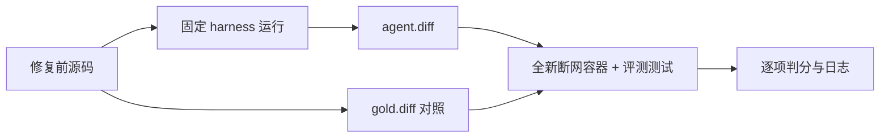

# 四个自创任务

来源：个人项目的真实修复提交，见 `sources.json`。源码 bundle 只包含修复前及更早的历史；Docker 构建不依赖本机原项目路径。`gold.diff` 仅包含相关生产代码，回归测试单独保存在各任务的 `tests/` 中。

| index | instance_id | 修复提交 |
| --- | --- | --- |
| 0 | shield-recovery | CodexPlayground `ad70966` |
| 1 | piw-safe-update | piw `e6ab51f` |
| 2 | hud-status-metadata | z24-pi-extensions `e87235b` |
| 3 | hud-hidden-locks | z24-pi-extensions `f31498a` |

## 复现

从 `assignment2/` 执行，配置 `OPENROUTER_API_KEY`。镜像按需构建，依赖在构建时安装，判分时断网。

```bash
IID=shield-recovery
docker build -t "cs2680-mytest/$IID:v1" "mytest/tasks/$IID"
bash mytest/verify.sh "$IID"                         # 基线：预期 unresolved
bash mytest/verify.sh "$IID" "mytest/tasks/$IID/gold.diff"
bash mytest/run.sh 0 > "mytest/results/$IID.agent.log" 2>&1
bash mytest/verify.sh "$IID" "mytest/results/$IID.agent.diff"
```

`tasks.json` 是四个任务的统一入口。`run.sh` 固定使用 `e7a0e61` 的 harness、OpenRouter、`qwen/qwen3.6-35b-a3b`、`reasoning.enabled=true`，复用课程 `run_task.sh`。只挂载 harness 文件，不向 agent 挂载 gold 或评测数据；完整 trace 位于 `../madsLoop_logs/<instance_id>/`。

`verify.sh` 在全新容器中复位基线、应用候选补丁、恢复评测测试及配置，逐项检查 `fail_to_pass` / `pass_to_pass`。测试缺失、跳过、失败或测试进程异常均不能通过。退出码：0 通过，1 未解决，2 环境失败。



本轮 **1/4 通过**。`solved.json` 是直接通过的 1 项，`unsolved.json` 是未解决的 3 项，`solved_after_change.json` 为空；没有改进 harness 后再运行的实验。

`results/summary.json` 汇总模型结果、token、trace、镜像 ID 和补丁校验值。逐任务日志：`before` 为基线，`agent.log` 为模型运行，`agent-eval` 为模型判分，`gold` 为真实修复判分；`after` 按作业约定保存通过任务的模型结果、未解决任务的 gold 结果，不代表模型全通过。

结果见 `results/` 和 [实验记录](../docs/3-全量测试结果与自创任务评测.md)。不为满足课程 2+2 要求调整结果分类。
