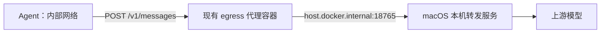

# 本地测评指标

运行 `python3 evaluation_scripts/run_all.py --limit 1` 测试第一道题；省略 `--limit` 顺序运行全部任务。
当前 dispatcher 固定最多一个在飞任务，`A3_MAX_LIVE` 不再生效。当前任务完成（包括返工、评测和清理）后才能领取下一题。
`Agent.solve()` 为每道题创建独立的 ReActBase3ToolHarness；对话历史保存在该 Harness 中，每次 run(task) 都重建。模型 HTTP 客户端可以复用，它不保存对话消息。
当前使用 expert 档位，通过 exec/read_text/write_text 三个工具解题；无工具调用的正常最终文本结束循环。MADSOPT_MAX_ITERATIONS 默认 100，限制单题模型调用次数。达到上限或收到不完整响应时保留实际调用计数并记录停止原因。
solve() 在循环结束后提取补丁并评测。失败后默认最多返工 2 次（MADSOPT_MAX_REWORKS），因此最多评测 3 次；同一题的返工保留历史和代码，共享 100 次调用预算。单题异常会记录原因、保存补丁并关闭任务，然后继续下一题。未填写学生姓名时，本地运行使用 local_<UTC 时间> 会话 ID。

## 输出

- `run_all_results.md`：逐题结果、评测次数、失败评测次数、返工次数、E2E、token 和美元成本，以及整轮汇总。
- `run_logs/metrics.json`：上述指标的结构化数据、完整性标记，以及本次模型名称和价格快照；不包含 API key 或 base URL。
- `run_logs/evaluations.tsv`：原有的逐次评测记录。
- `run_logs/task_times.tsv`：原有的任务起止墙钟时间；开始时间在沙盒启动后，与新增 E2E 的起点不同。
- `madsOpt_logs/<k>/run.jsonl`：模型和工具调用日志；运行中原始文件在 `.tasks/trace/madsOpt_logs/<k>/run.jsonl`，汇总直接读取该原始文件。

## 本机转发服务与容器连接

当前三个档位使用 `api_format: messages`，上游地址为 `http://host.docker.internal:18765/v1`，分别选择 gpt-6.1-sol、gpt-5.6-terra 和 gpt-5.6-luna。
`api_key: local-no-auth` 只是现有 SDK 要求的占位值，本机服务不需要真实 key。价格已按 2026-10-29 官方标准 API 价格填写（输入不超过 272K token），用于 API 等价成本估算，不是订阅实际账单；不自动计算长上下文加价。以后价格留空仍表示未知。

本地 dispatcher 没有美元预算上限，也不会因累计估算成本达到 $10 而停止；成本在运行结束后汇总。课程线上每次提交 $10、每日 $30 的预算限制不由这份本地代码执行。



runner 仍把 Agent 的 base_url 改写为各档位的内部代理地址，代理向 YAML 中的上游地址转发。
Docker Desktop 已提供 host.docker.internal，不需要额外发布容器端口，也不需要把 Agent 改成 host 网络。
这是 macOS Docker Desktop 的配置；容器内的 127.0.0.1 指向容器自身，不能替代上述宿主机地址。

Harness 对 Messages 协议转换 system、工具 schema、tool_use 和 tool_result，并将响应归一化为现有 loop 使用的 tool_calls/finish_reason 结构。
默认 max_tokens 为 4096，可通过模型调用参数覆盖。当前只适配非流式文本及工具调用；原生响应内容块会保留并回传，避免丢失 thinking 等信息。
省略 api_format 时仍使用原来的 chat_completions 协议，因此 OpenRouter 配置可继续使用原路径。

## 口径

`rework_count` 只在已完成的评测失败之后，接受 `continue_task(k)` 时加一。
失败后直接结束不算返工；没有新评测而连续调用 continue 不重复计数；成功后 continue 不算失败返工。
因此它不等于原有的 `attempt`，后者从 0 开始，每次 continue 都会增加。
`evaluations` 是实际完成的评分流程数量，`failed_evaluations` 是其中未解决的次数。
`done()` 自动触发的评分也计入；包括从未评测且无补丁时由脚手架执行的空补丁失败评分。

逐题 `e2e_seconds` 使用单调时钟，从 dispatcher 接受 next_task 请求、准备启动沙盒开始，到最终评分及沙盒/补丁目录清理结束。
它包含推理、工具执行、失败返工、评测排队与执行、容器启动和清理。
整轮 E2E 是第一题开始到最后一题结束，包含两题之间的间隔，不含首题之前的镜像准备/公共网络启动和末题之后的公共设施清理。
没有领取的任务 E2E 为 null，token/成本为 0，并标记 opened=false。

`input`、`cache`、`output` 统一为 **美元 / 100 万 token**；cache 是缓存命中输入价格。
价格字段可留空，已填写的值须为有限、非负数。缺失档位仍静默跳过，多余档位仍忽略。

```text
每次请求成本 = ((prompt_tokens - cached_prompt_tokens) × input
                + cached_prompt_tokens × cache
                + completion_tokens × output) / 1,000,000
```

`prompt_tokens` 已包含缓存命中 token，`completion_tokens` 按上游返回值使用，推理 token 不重复累加。
Messages 协议的 input_tokens 不含缓存读取/写入量，因此适配层将两者加回 prompt_tokens，并把 cache_read_input_tokens 记为 cached_prompt_tokens。缓存写入暂按 input 单价估算；当前三价格字段不单独描述缓存写入溢价。
如果上游未返回 `prompt_tokens_details.cached_tokens`，按没有报告缓存命中处理，即 0。
模型调用必须经过 `Harness._call_model("standard", messages, iteration, tools=tool_schemas)` 或写入等价的 `logger.api_request()` 事件。
Harness 自动记录 model_tier，以区分“同一模型名称、不同档位/上游价格”；手动写日志省略该字段时，只有模型名称唯一匹配才计价。

缺少 usage、必要单价、唯一的模型匹配，或日志不完整时，`cost_usd` 为 null，Markdown 显示 unknown。
`known_cost_usd` 保留可完整计价请求的小计，token 字段保留有效 usage 的小计；`usage_complete` 和 `cost_complete` 表示能否作为完整统计使用。
没有调用模型且日志正常结束时，成本为 0。只有实际使用的 token 类别才需要对应价格，例如没有缓存命中时不需要 cache 价格。

这些成本是按本次配置和已记录 usage 计算的估算值，不是上游账单对账结果；不会捕获绕过日志的调用、请求失败后未返回的计费用量。SDK 自动重试已关闭，单次请求超时为 120 秒。
正常结束、时间限制、手动中断和 runner 异常退出都会尽可能写出汇总。中断的任务标记 finished=false，并记录 end_reason 和截至清理完成的 E2E；不会冒充正常完成。api_start/api_error 记录请求开始和异常；有错误或未收到响应的请求时，成本标记 unknown，同时保留已知 token 和成本小计。SIGKILL 或主机断电无法执行收尾，只能保留已刷盘的原始日志。

## 离线检查

```bash
python3 -B -m unittest discover -s tests -v
```

不需要 Docker、不调用真实模型、不产生 API 费用。
